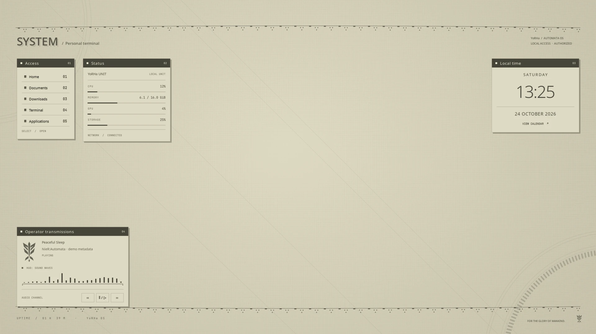
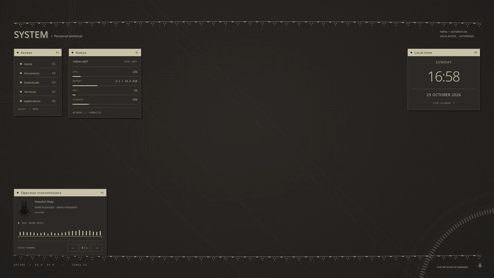
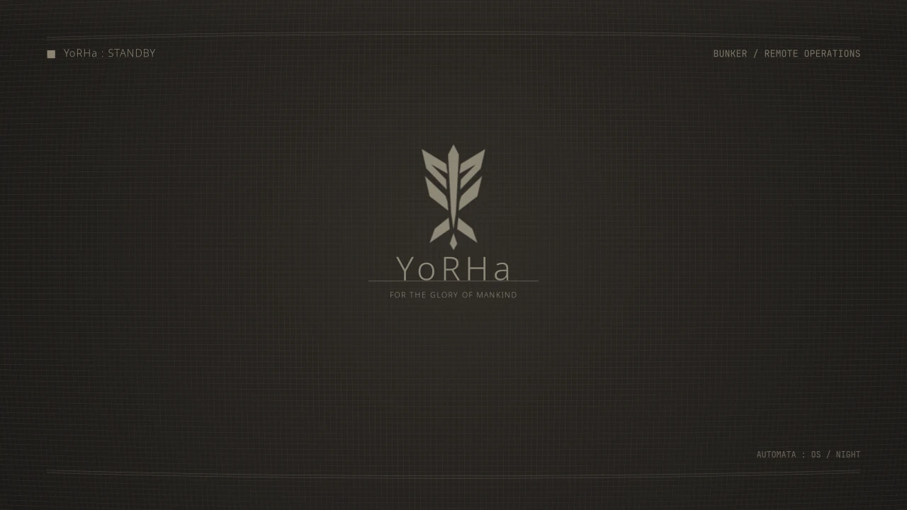
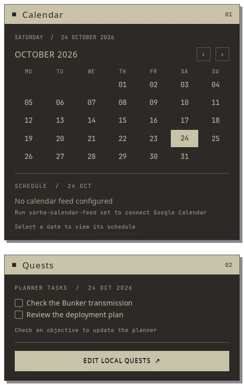

# YoRHa Desktop

A NieR:Automata inspired Hyprland desktop: parchment and graphite palettes, floating menu panels, a quest log, procedural wallpapers and a rotating standby crest.

**Status: public beta.** Intended for users comfortable with Hyprland configuration. Validated on an existing Fedora 44 desktop with Hyprland 0.56.2 and Python 3.14.8. Fresh Fedora/Arch installations, current Arch runtime behavior and fractional scaling still need validation. The installer does not currently enforce Hyprland version compatibility; review [validation and scope](#validation-and-scope) before installing.




## Install

Start from a Linux desktop with working graphics, systemd user services, Git and Python 3. Native dependency scripts support **Fedora and Arch Linux**. Fedora may need its optional community package sources for Hyprland tools and Starship. Run as your normal desktop user; the installer invokes `sudo` only for distribution packages.

```sh
git clone https://github.com/sashavrg/yorha-desktop.git
cd yorha-desktop
./install.sh
```

The terminal wizard walks through layout, palette, widgets, standby, application themes, optional assets and dependency installation. On Fedora it also offers `solopasha/hyprland` and `atim/starship` COPRs, disabled unless selected; Arch uses its official repositories. It shows a plan before applying anything. Package managers retain their own confirmation prompts. There is no `curl | sh`, AUR helper or whole-system upgrade. See [Fedora package sources](docs/INSTALL.md#fedora-package-sources) for the community repository options.

- **Overlay:** retains your main Hyprland config and monitor rules; adds one source line. Managed application configs are backed up and replaced. Existing startup commands remain: review them if another dotfile framework also changes wallpapers or colors.
- **Standalone:** writes a small complete Hyprland config with automatic monitor discovery and workspace/navigation bindings. It backs up an existing main config first.

By default the current session stays as it is until the next Hyprland login. The wizard can explicitly reload it immediately. It never logs you out or restarts your display manager.

Inspect without writes, downloads or service calls:

```sh
./install.sh --dry-run
./scripts/install-deps.sh --distro fedora --dry-run
```

For an unattended configuration install with prerequisites already present:

```sh
./install.sh --yes --no-deps --layout overlay --mode night
```

`--yes` accepts installer defaults; it does not suppress package-manager authentication or confirmation. See `./install.sh --help` and [installation details](docs/INSTALL.md).

## What is included

- Matched **day/night** profiles for Hyprland, Waybar, Rofi, SwayNC, Kitty, Hyprlock, GTK 3/4, Qt/Kvantum, KDE colors, Starship, Fastfetch, Btop, Cava and Neovim palettes.
- **Floating desktop panels:** Access, machine telemetry, Local time and Operator transmissions with real MPRIS media controls. They sit above the wallpaper and below normal windows.
- **Calendar and Quests:** interactive date selection and local checkable tasks; optional private Google Calendar iCal feed and optional compatible planner connection. No account is needed for local quests.
- **Sound Waves HUD:** a shared 24-band Cava analyser drives Waybar and the media panel from the playback monitor. It never selects a microphone.
- **Standby:** one unlit perspective-projected crest, a 60-second rotation, slow vertical bob, fine grain and quiet transmission messages. Mouse/keyboard dismisses it; Hyprlock provides authentication separately.
- Procedural landscape/portrait wallpapers with a woven grid, edge fringing and gentle lens distortion. Generated locally from source.
- Optional SDDM theme and optional DroidCam USB/Wi-Fi button.
- **Native system dialogs and command console:** matching Hyprtoolkit palettes, square corners, explicit power confirmations and Super + R command entry. Uses separately installed `hyprland-guiutils` when available, with a themed Rofi fallback.

The **YoRHa game emblem is used throughout**, alongside packaged Noto Sans / JetBrains Mono and system Breeze icons. Every normal install downloads a community SVG trace from a pinned upstream revision and verifies its checksum before generating the wallpapers and other visuals. This also applies to unattended `--yes` installs; there is no separate logo choice or alternative crest. Internet access is required for the emblem download. The game SVG is not bundled or relicensed. See [asset credits](THIRD_PARTY.md).

## Daily controls

| Shortcut | Action |
| --- | --- |
| Super + Enter | Kitty terminal |
| Super + D | Application/search launcher |
| Super + R | Command console (native Hyprland Run when available) |
| Super + A | Window overview |
| Super + B | Default browser at a valid blank page |
| Super + E | Home folder in your default file manager |
| Super + L | Authenticated lock |
| Super + Space | Toggle floating, fit within the window's own monitor and center |
| Super + Alt + Space | Reversibly float the workspace; preserve existing floating windows |
| Super + N | Communications / notifications |
| Super + Escape | System menu; destructive power actions require confirmation |
| Super + Alt + N | Toggle day/night |
| Super + Alt + W | Show/hide selected desktop widgets |
| Super + Alt + S | Preview standby |
| Super + Alt + R | Reload theme components |

The wizard can leave your key bindings alone. Standalone also supplies Super + Q/F, Super + 1…0, Super + Shift + 1…0, Super + H/J/K/semicolon and Super + mouse drag. Moving a floating window with Super + Shift + 1…0 preserves its width, height and position as percentages of the monitor's usable area. An 80% × 80% window remains 80% × 80% when moved between landscape and portrait displays.

**Overlay installs retain existing numbered workspace-move shortcuts.** To enable the proportional movement described above, route those shortcuts through `~/.local/bin/yorha-move-workspace NUMBER` (1–10) in your own Hyprland config. The wizard currently adds these bindings automatically only in standalone mode. See [overlay configuration](docs/INSTALL.md#overlay-workspace-movement).

```sh
yorha-mode day
yorha-mode night
yorha-desktop toggle
yorha-standby preview
yorha-doctor

yorha-tasks add "Review today's objectives"
yorha-tasks list
yorha-tasks menu
```

Commands live in `~/.local/bin`; add it to your shell's PATH if your distribution does not already do so.



## Customize and recover

Edit visual sources in `~/.local/share/yorha/modes/{day,night}`, then reapply the mode. Live managed files are regenerated when modes change. Edit monitor/input settings in your own Hyprland config. Toolkit applications may need reopening after a palette switch; application-supplied RGB colors and web content can bypass the theme.

Before replacing a file, the installer saves its contents, permissions or original symlink in a private transaction directory:

```sh
yorha-restore --list
yorha-restore ~/.local/state/yorha/backups/TIMESTAMP --stop-services
# Also works from the clone, including after an interrupted installation:
python3 scripts/restore.py ~/.local/state/yorha/backups/TIMESTAMP --stop-services
```

Recovery checks for subsequent edits before changing files. Save any edits you want to keep, then add `--force` if necessary, including after a palette switch. Recover multiple installation transactions newest first. Backups are retained. Dependencies installed through your package manager remain installed. See [recovery and updates](docs/INSTALL.md#recovery).

## Optional connections



- [Calendar, quests and monitor behavior](docs/WIDGETS.md)
- [SDDM login theme](docs/SDDM.md)
- [USB/Wi-Fi DroidCam addon](docs/PHONECAM.md)
- [Native dialogs, command console and safe previews](docs/NATIVE-UI.md)
- [Architecture and development](docs/DEVELOPMENT.md)
- [Fedora 44 / Hyprland 0.56 upgrade checks](docs/UPGRADING.md)

The portrait display receives Calendar/Quests when present; otherwise they use the primary physical display. Main panels prefer a landscape display. Layout reduces crowded cards on smaller single-monitor setups. EDID-less outputs are excluded by default; `include_edidless` enables them. Keep your own monitor rotation/scaling configuration. Typical targets are 1920×1080 or larger at 1× and a portrait companion; very small logical displays may need fewer panels. Waybar, widgets and wallpaper skip conventional headless/streaming outputs.

## Validation and scope

Automated tests cover leaf and parent symlinks, outside-home refusal, interrupted installs, edit protection, idempotent overlay setup, update/restore, dry-run behavior, task revision conflicts and floating-window movement. A native SVG-loading check also runs when its GTK dependencies are available. A ready-to-enable [GitHub Actions template](docs/ci-checks.yml) runs the suite without touching a real desktop; no GitHub Actions workflow is currently enabled. Development checks also stage complete installs, render both palettes, validate generated Hyprland configuration and check SDDM assets.

The initial version was staged and rendered on Fedora 42 with Hyprland 0.51.1. The current upgrade audit checks Fedora 44, Python 3.14.8 and Hyprland 0.56.2: live palettes, widgets, shortcuts, both monitor orientations, proportional floating-window transfers and SDDM preview. The current configuration is validated against Hyprland 0.56.2; the historical staging check does not establish compatibility with older versions after subsequent configuration changes. Fedora and Arch package scripts are provided; fresh virtual-machine installs, current Arch runtime behavior and fractional scaling have **not** been validated. Other distributions require manual dependency installation. This is a Hyprland/Wayland setup; GNOME/KDE sessions and X11 are outside the installer scope. Nonstandard XDG config/data roots are not currently supported. No tagged release is available yet.

Phone launchers, personal cloud accounts, private planner servers, streaming servers, GPU drivers and machine-specific monitor layouts are outside this repository. The optional streaming idle guard recognizes `$XDG_RUNTIME_DIR/sunshine-streaming`; your own stream hooks must maintain it.

Original project code/artwork: GPL-3.0-or-later. Third-party files retain their individual licenses; game branding remains with its respective owners. This is an unofficial fan project.
