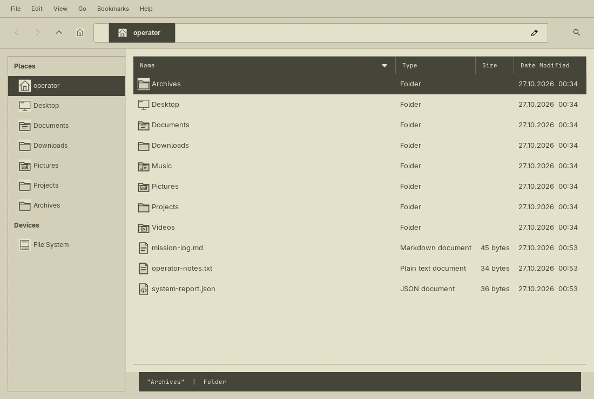
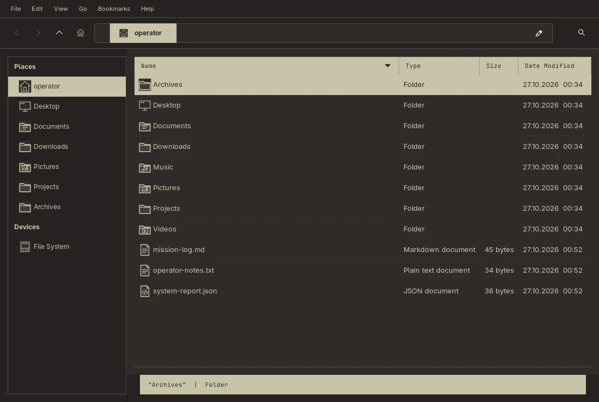

# Archive explorer / Thunar

The YoRHa GTK 3 themes include a Thunar-specific archive layout: a framed navigation pane, tab-like breadcrumbs, an inverted column-header band, spaced file rows, a subtle grid and a compact monospace status strip. Selected files, selected breadcrumbs and menu entries use explicit foreground/background pairs in both palettes.




The icon themes supply original geometric folder, device and common document-type icons, with system Breeze inheritance for other icons. Small two-tone tiles keep the glyphs visible against selected rows. These assets are generated by `scripts/render-explorer-icons.py`; no copies of the author's recolored Breeze collection are included. Existing application icons continue to come from the installed parent theme.

## Installation and daily use

The GTK themes and archive icons are installed with the wizard's application-theme component (`apps`, included by default). Thunar itself is optional and is not selected as the system file manager by the installer. The archive CSS is scoped to Thunar; other GTK applications keep the general YoRHa theme.

If you use Thunar, apply the optional layout preset from your desktop session:

```sh
yorha-thunar-layout apply
```

Then close and reopen Thunar. The preset selects details view, breadcrumb navigation, a shortcuts pane, Name / Type / Size / Date Modified columns, compact toolbar icons and numeric modification dates. It uses regular two-tone icons in the sidebar and breadcrumb toolbar so their glyphs remain readable on selected backgrounds. Menus, bookmarks, mounts, thumbnails, file associations and file-operation behavior remain available through Thunar.

The existing Super+E file-manager binding continues to open your chosen application. With the standalone configuration, Super+E opens the default folder handler; set Thunar as that handler through your desktop's normal settings if desired. `yorha-mode day|night` selects the corresponding GTK and icon themes; applications may need reopening to reload their styles.

## Restore the layout

Before changing visual preferences, the helper stores their previous values in the private file `~/.local/state/yorha/thunar-layout.json`. Properties that were originally absent are removed again on restoration. Reapplying the preset retains the original backup, and a failed application attempts to roll back the managed properties.

```sh
yorha-thunar-layout status
yorha-thunar-layout restore
```

Reopen Thunar after restoring. This restores only the preset's preferences. To undo a full theme installation, restore the layout first, then follow the [installer recovery procedure](INSTALL.md#recovery) for themes and icons. The preset does not modify files, custom actions, permissions settings or bookmarks.

## Verification

Checked with Thunar 4.20.9 / GTK 3.24 on Hyprland 0.56.2. Both palettes were inspected with sample files, selected rows and menus. Automated checks cover layout restoration, rollback after partial preference updates and contrast within every original icon tile. The complete suite passed 35 tests on 2026-10-27.
