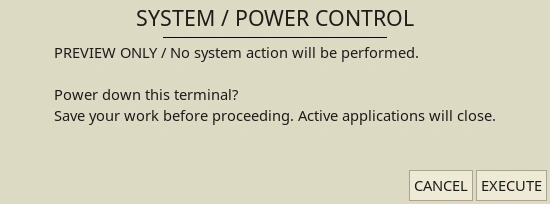
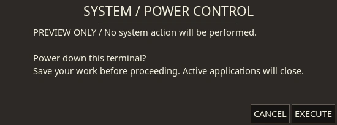

# Native Hyprland interface

YoRHa supplies day/night Hyprtoolkit palettes for native Hyprland utilities: warm parchment by day, charcoal and ivory by night, square corners, Noto Sans headings and JetBrains Mono for monospace elements. The profiles are managed through `~/.config/hypr/hyprtoolkit.conf` and switch with `yorha-mode` alongside the rest of the desktop. Edit their sources under `~/.local/share/yorha/modes/{day,night}/.config/hypr/` to customize them.




## Utilities and installation

The integration uses [hyprland-guiutils](https://github.com/hyprwm/hyprland-guiutils), when installed separately. Its `hyprland-dialog` and `hyprland-run` commands must be on PATH or in `~/.local/bin`. The theme installer supplies the palettes, window rules, shortcuts and wrappers; it does not build third-party utilities or add a mandatory native package unavailable in some distribution repositories. Without the native tools, the same wrappers use the existing themed Rofi installation.

## System confirmations

Super + Escape opens System Control. Choosing Log out, Reboot or Shut down opens a confirmation with `CANCEL` and `EXECUTE`. Only an explicit successful `EXECUTE` response approves the request. Closing the window, cancelling, an empty response or a failed dialog cancels it. A failed system request displays an operator notice.

Inspect the actual confirmation without performing a system action:

```sh
yorha-power --preview shutdown
yorha-power --preview reboot
yorha-power --preview logout
```

Preview mode labels the window clearly and never dispatches an action, including when `EXECUTE` is clicked. Automated checks exercise that behavior using disposable command stubs. Installation checks do not shut down, reboot, suspend or end a real session.

Scripts can show a notice or request explicit confirmation through the shared wrapper:

```sh
yorha-dialog message --title 'SYSTEM / OPERATOR NOTICE' --text 'YoRHa interface ready.'
yorha-dialog confirm --title 'SYSTEM / REQUEST' --text 'Proceed with this request?'
```

The confirmation command returns success only for `EXECUTE`; displaying the dialog itself does not perform another action.

## Command console

Super + R opens `yorha-run`: the native `hyprland-run` window when available, otherwise Rofi's run prompt. Another press focuses an existing native console. Super + D continues to open application search. These shortcuts are installed unless `--no-bindings` is selected.

The native console launches the command entered by the user. It uses the stock utility's layout and wording with the YoRHa palette. `hyprland-dialog` and `hyprland-run` windows float and center on their monitor. Other Hyprtoolkit applications also read the shared palette.

## Verification

The integration was checked against hyprland-guiutils 0.2.2 and Hyprtoolkit 0.5.4 on Hyprland 0.56.2. Palette checks cover body text, regular and accent buttons, the native console's derived placeholder color and its translucent text-selection overlay in both modes. The native tools are optional; Rofi remains a required core dependency.

Live checks confirmed that an open native window updates after an atomic palette switch and that a second console invocation focuses the existing window. The generated standalone configuration also passed Hyprland's parser. The complete automated suite passed 32 tests on Fedora 44 on 2026-10-26; power-command checks use stubs.
